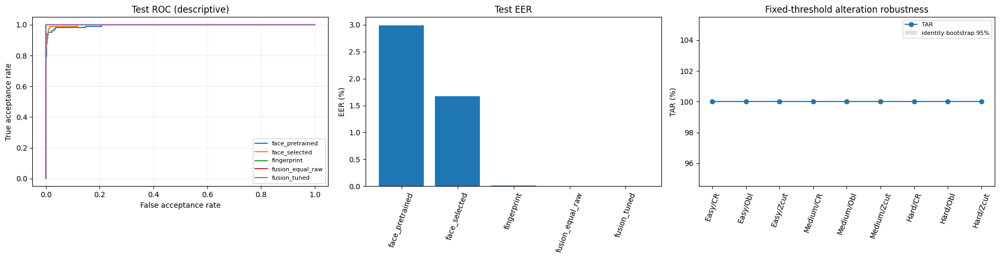
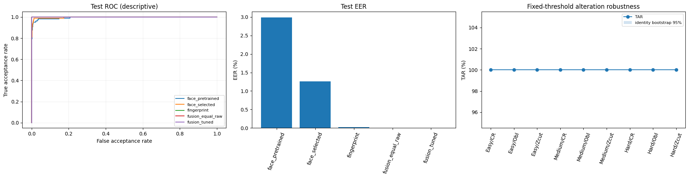
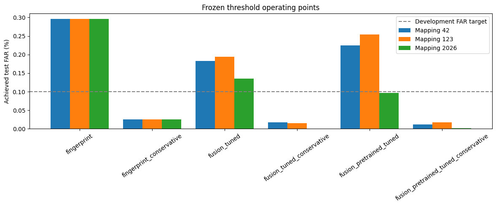

# Multimodal biometry overview

Fingerprint and face verification with score-level fusion, using SOCOFing fingerprints and Labeled Faces in the Wild (LFW) faces. This repository contains two standalone Kaggle notebooks, with their saved outputs and execution counts cleared. Selected recorded graphs and important results are presented below.

- [v2 notebook](./mm-biometric-system-v2.ipynb): the selected reference experiment.
- [v3 notebook](./mm-biometric-system-v3.ipynb): the faster optimized comparison experiment.

## Run on Kaggle

1. Import either notebook into Kaggle.
2. Attach [SOCOFing](https://www.kaggle.com/datasets/ruizgara/socofing) and [LFW](https://www.kaggle.com/datasets/jessicali9530/lfw-dataset).
3. Enable a T4 GPU and Internet access for package and pretrained-weight downloads.
4. Review the configuration cell. Input paths are discovered automatically and can be overridden; use a new run name for a new experiment.
5. Run all cells, save the executed notebook, and download the exported run archive.

The notebooks install `facenet-pytorch==2.6.0` without replacing Kaggle's installed PyTorch, torchvision, or NumPy stack. No companion scripts, existing checkpoints, or project CSVs are needed. Fresh training runs may produce different checkpoints and metrics.

## Recorded comparison

These results summarize the original saved runs; clearing notebook outputs does not constitute a new experiment. v2 is the reference choice because it recorded fewer fingerprint false accepts and higher adapted-face genuine acceptance. v3 improved face EER and face FAR and reduced total runtime.

Each test mapping contains 954 genuine alteration trials and 100,170 impostor trials from 106 subjects. Slash-separated counts follow mapping seeds **42 / 123 / 2026**. Each run uses its own frozen development thresholds.

| Measure | v2 | v3 |
|---|---:|---:|
| Fingerprint false accepts, ordinary threshold | 82 | 296 |
| Fingerprint FAR, ordinary threshold | 0.081861% | 0.295498% |
| Fingerprint false accepts, conservative threshold | 18 | 26 |
| Adapted-face fusion false accepts, ordinary tuned threshold | 133 / 67 / 61 | 183 / 194 / 135 |
| Adapted-face fusion false accepts, conservative threshold | 9 / 8 / 4 | 17 / 15 / 1 |
| Pretrained-face fusion false accepts, conservative threshold | 0 / 17 / 1 | 12 / 18 / 2 |
| Fingerprint EER | 0.016971% | 0.017969% |
| Adapted-face TAR | 90.566038% | 84.905660% |
| Adapted-face FAR | 0.305481% | 0.179695% |
| Adapted-face EER | 1.671159% | 1.257862% |
| Total recorded notebook runtime | 31 min 25 sec | 12 min 23 sec |

FAR is the false acceptance rate; TAR is the true acceptance rate; EER is the equal error rate. Fingerprint and conservative fusion accepted all 954 genuine trials per mapping at the operating points above. v3's recorded total runtime was 60.6% lower. The runs changed training and checkpoint selection, so this does not isolate the effect of one optimization.

The selected fingerprint checkpoints were **epoch 9 in v2** and **epoch 6 in v3**; the selected adapted-face checkpoints were **epoch 6 in v2** and **epoch 2 in v3**. Selection used model-validation performance, with thresholds subsequently calibrated on separate development identities. The face models rejected 10 versus 16 distinct genuine face pairs on test, respectively.

## Graphs from the recorded notebooks

### v2: verification overview

Original figure from v2's final **Plots and export** cell, using mapping seed **42**. The panels show descriptive test ROC curves, test EER by method, and the tuned adapted-face fusion TAR across nine synthetic fingerprint alteration conditions.

### v3: verification overview

Original figure from v3's final **Plots and export** cell, also using mapping seed **42**. The adapted-face EER is lower than v2's. The flat 100% fusion TAR line in both figures records no observed genuine rejection in this cohort; it does not show the methods' false acceptance rates or guarantee zero error on new subjects.

### v3: ordinary and conservative thresholds

Original v3 operating-point figure for mapping seeds **42, 123, and 2026**. The dashed line is the **0.1% development FAR target**. Ordinary fingerprint verification exceeds that target on test; conservative thresholds reduce observed false accepts substantially. Each bar uses a frozen development threshold. The figure shows point estimates, while conditional bootstrap intervals and repeated-subject sampling limit population conclusions.

These three PNGs are extracted directly from the saved notebook output cells. The figures have not been regenerated, and no new training was performed for this overview. The source runs were `biometric_v2_20261110T092929Z` and `biometric_v2_optimized_20261111T175419Z`.

## Research scope

Face and fingerprint subjects are unrelated people paired into synthetic identities. The experiment evaluates chimeric fusion and synthetic fingerprint alteration robustness. It does not establish real same-person multimodal performance, liveness, physical spoof resistance, or deployment readiness.

The mappings reuse subjects and captures; they are pairing-sensitivity checks rather than independent training experiments. Face-only genuine results represent 106 distinct face pairs per mapping. Both runs reuse a previously inspected test cohort, so their comparison is exploratory. Pretraining identity overlap has not been audited.

Threshold choice matters: zero EER does not imply zero false accepts at a calibrated threshold, and zero observed errors do not guarantee zero population error. Validation on fresh subjects, repeat acquisitions, and multiple training seeds remains necessary.
